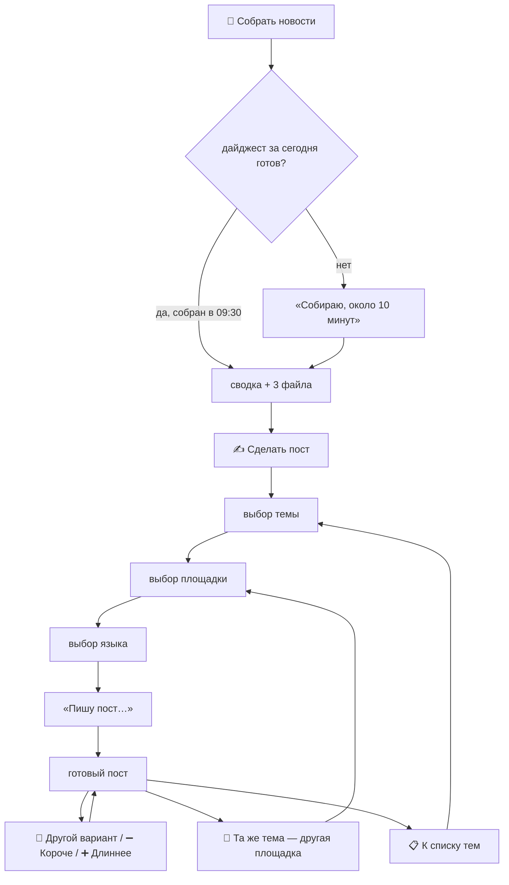

# Этап 10. Telegram-бот

**Цель.** Админ и СММ работают с системой только через Telegram:
1. нажимают «Собрать новости» и получают дайджест сегодняшнего дня;
2. выбирают тему и площадку;
3. получают от Claude готовый пост под Telegram, LinkedIn, Threads, Instagram (список расширяемый).

Терминал, файлы и ярлыки не нужны. Бот — тонкий интерфейс к слою управления `service.py` (этап 8) и генератору постов (этап 7): всё, что он делает, уже работает и проверено на пилоте.

**Оценка:** 3 дня. **Зависит от:** приёмки пилота (этап 9) и ответов команды из раздела «Требования к боту» этапа 9.

**Почему после пилота.** Бот не меняет качество дайджеста и постов, он только меняет способ доступа к ним. Если подключить его раньше, на пилоте пришлось бы отделять ошибки отбора, перевода и постов от ошибок интерфейса.

---

## Пользователи и права
Белый список в `settings.yaml`. Остальным бот не отвечает.

```yaml
bot:
  users:
    - {telegram_id: 111111111, name: "Админ", role: admin}
    - {telegram_id: 222222222, name: "СММ", role: smm}
```

| Действие | admin | smm |
|---|---|---|
| Собрать новости / получить дайджест | ✅ | ✅ |
| Сделать пост | ✅ | ✅ |
| Обновить дайджест (пересобрать с новостями после утра) | ✅ | — |
| Статус системы | ✅ | — |
| Сообщение, если утренний дайджест не собрался | ✅ | — |

## Сценарий



1. **📰 Собрать новости** — `service.get_or_build_digest()`.
   - **Дайджест уже готов** (утренняя сборка в 09:30): бот сразу присылает сводку одним сообщением и три файла `digest.{ru,en,uz}.md`. Сводка: дата, число статей, заголовки по разделам с номерами, курсы ЦБ, не больше 4096 символов.
   - **Не готов** (ноутбук был выключен): «Собираю новости, это около 10 минут, пришлю сюда». Сбор идёт в фоне, бот отвечает на другие кнопки.
   - **Сбор уже идёт** (нажал второй пользователь): «Сбор уже идёт, пришлю, как будет готово».
2. **✍️ Сделать пост** — кнопка под сводкой.
3. **Тема.** Список тем дня (`list_topics`) кнопками: `005 · Налоги · Взыскание задолженности за счёт…`. По 8 на страницу, с листанием, сгруппированы по разделам в порядке важности.
4. **Площадка.** Кнопки из `config/posts.yaml`: Telegram, LinkedIn, Threads, Instagram. Новая площадка появляется в боте после добавления в конфиг.
5. **Язык.** ru / uz / en. Язык площадки по умолчанию отмечен. Если для площадки задан один язык, шаг пропускается.
6. **Пост** — `make_post()`. «Пишу пост…», через 10–30 с приходит текст отдельным сообщением, удобным для копирования. Для Telegram бот дополнительно показывает пост с оформлением (жирный, ссылки), как он будет выглядеть в канале.
7. **Под постом:**
   - «🔁 Другой вариант», «➖ Короче», «➕ Длиннее» — новый вызов Claude в том же режиме;
   - «📱 Другая площадка» — та же тема, снова выбор площадки;
   - «📋 К темам» — назад к списку;
   - «👎» — короткий вопрос «что не так?», ответ пишется в `feedback` (тип `post`) для настройки промпта.

   Если проверка поста нашла проблему (этап 7), текст приходит с пометкой «⚠️ проверить: …».
8. **Админ:**
   - «🔄 Обновить дайджест» — пересборка за сегодня с новостями после утра (`force=True`);
   - «ℹ️ Статус» — текст из `describe()`;
   - сообщение, если утренний запуск не удался.

**Когда ноутбук выключен или спит.** Telegram хранит нажатия до 24 часов. После пробуждения бот обработает их и пришлёт ответ. На «Собрать новости» придёт дайджест, как только завершится сбор.

**Лимиты Claude.** Если лимит подписки исчерпан, бот так и пишет: «Лимит Claude исчерпан, сброс около 14:00. Дайджест доступен, посты — после сброса». Дневной лимит постов `posts.max_per_day` (этап 7) тоже сообщается понятным текстом.

---

## Устройство
- **Процесс.** Отдельная команда `uzdigest bot`.
  - Работает через long polling: бот сам опрашивает Telegram. Сервер, публичный адрес и открытые порты не нужны.
  - Задача Планировщика `UzDigest-Bot` запускает бота при входе в Windows и перезапускает при сбое.
  - Защита от второго экземпляра: `data/bot.lock`.
- **Библиотека.** `python-telegram-bot` (асинхронная, есть диалоги и встроенные кнопки). Версию выбрать и зафиксировать в `pyproject.toml` при реализации.
- **Долгие действия.**
  - Сбор запускается отдельным процессом (`python -m uzdigest run`), результат бот узнаёт через `status()`.
  - Посты генерируются в фоновом потоке, по одному на пользователя.
  - В обоих случаях бот не зависает и отвечает на другие кнопки.
- **Состояние диалога** (выбранные тема, площадка, язык) хранится на стороне бота по короткому ключу. Telegram ограничивает данные кнопки 64 байтами, поэтому в кнопку кладётся только ключ.
- **Секреты.** Токен бота — в `.env` (`TELEGRAM_BOT_TOKEN`), в `.env.example` пустая строка с подсказкой. В логи не попадает. Попытки доступа чужих пишутся в лог только с ID.
- **Безопасность.**
  - Бот не выполняет произвольных команд и не меняет конфиг и источники.
  - Текст ответа на «👎» — данные: он сохраняется в `feedback` и в Claude как инструкция не уходит.
- **Язык интерфейса** — русский. Тексты кнопок и ответов — в `config/i18n.yaml`.

## Что нужно от команды до начала
1. Ответы на вопросы из раздела «Требования к боту» этапа 9.
2. **Создать бота в @BotFather** — это делает человек из команды: Claude не регистрирует аккаунты от имени пользователя.
   - Как: `/newbot`, задать имя, получить токен.
   - Токен передать оператору, который запишет его в `.env`.
3. Админ и СММ пишут боту `/start`. Бот покажет их Telegram ID, оператор внесёт их в белый список с ролями.

---

## Задачи
1. **Зависимость** `python-telegram-bot` в `pyproject.toml`.
2. **`src/uzdigest/bot/app.py`** — запуск, проверка доступа и ролей, главное меню.
3. **`src/uzdigest/bot/digest_flow.py`** — «Собрать новости», «Обновить», «Статус», сводка в пределах 4096 символов.
4. **`src/uzdigest/bot/post_flow.py`** — диалог: тема → площадка → язык → пост → действия под постом. Вся логика — вызовы `service.list_topics` и `service.make_post`.
5. **`src/uzdigest/notify/telegram.py`** — уведомитель для `notify:`: сообщение админу о неудачном утреннем запуске.
6. **Настройки.** `settings.yaml`: секция `bot` (пользователи и роли). Тексты — `config/i18n.yaml`.
7. **`scripts/install_tasks.ps1`** — третья задача `UzDigest-Bot`: при входе в систему, перезапуск при сбое, без ограничения по времени.
8. **Инструкции.**
   - `docs/team-guide.md` — для админа и СММ: скриншоты меню, путь «новости → тема → площадка → пост», что делать, если бот молчит.
   - Раздел про бота в `docs/operations.md` (оператору): токен, белый список, роли, перезапуск.

## Тесты (без сети, `service.py` и Claude подменены)
- **Доступ:** чужой ID — нет ответа. smm не видит «Обновить» и «Статус», admin видит.
- **«Собрать новости»:** дайджест готов → сразу файлы. Не готов → фоновый сбор и ответ по окончании. Сбор уже идёт → «уже идёт».
- **Сводка:** длинный дайджест обрезается до 4096 символов с «и ещё N».
- **Диалог поста:**
  - листание тем;
  - пропуск шага языка при одном языке;
  - «Другая площадка» сохраняет тему;
  - «Короче» передаёт режим `shorter`;
  - отмена посреди диалога.
- **Ошибки:** лимит Claude, дневной лимит постов, пометка QA — понятные тексты.
- **Уведомитель:** неудачный утренний запуск → сообщение только админу. Ошибка Telegram не роняет `run`.

## Проверка на живом Telegram
1. СММ: «Собрать новости» в 10:00 → дайджест приходит сразу. Пост по теме для каждой из четырёх площадок → тексты укладываются в лимиты, копируются без мусора.
2. Ноутбук был выключен утром → «Собрать новости» запускает сбор, дайджест приходит через ~10 минут.
3. Админ и СММ нажимают «Собрать новости» одновременно → один сбор, оба получают дайджест.
4. Ноутбук спал во время нажатия → ответ пришёл после пробуждения.
5. Человек не из списка пишет боту → «Доступ запрещен».
6. «👎» под постом → замечание видно в `uzdigest feedback list`.
7. Утренний дайджест собран в 09:30 → оба пользователя получают список тем без нажатий, один раз.
8. «Другие дайджесты» → вчерашний день → тема → пост по ней.

## Готово, когда
- Все восемь проверок пройдены.
- Неделю админ и СММ работают только через бота. Терминал нужен только оператору для замены токенов и добавления источников.
- `docs/team-guide.md` написан, админ и СММ его прочитали.

---

## Итоги реализации (03.11.2026)

Бот сделан до пилота по решению команды: времени на пилот без бота нет, пилот идёт сразу через него.

Код: [bot/core.py](../../src/uzdigest/bot/core.py) (вся логика диалога без Telegram), [bot/app.py](../../src/uzdigest/bot/app.py) (long polling, белый список, отправка), [bot/notifier.py](../../src/uzdigest/bot/notifier.py) (сообщения админам о сбоях), `ops.single_instance` (`data/bot.lock`), секция `bot.users` в `settings.yaml`, задача `UzDigest-Bot` в `install_tasks.ps1`, команда `uzdigest bot`. Библиотека `python-telegram-bot` 22.8. Инструкции: [team-guide.md](../team-guide.md), раздел в [operations.md](../operations.md). Тесты: [test_bot.py](../../tests/test_bot.py).

### Решения, принятые по ходу работы
- **Пользователи** (03.11.2026): Telegram ID 999812790 и 7584910935, оба `admin`. Роль `smm` в коде есть, для новых пользователей.
- **Чужим бот не отвечает вообще**, их ID пишутся только в лог. Вместо «бот покажет ID на /start» — @userinfobot: так бот не раскрывает себя посторонним.
- **Логика отделена от Telegram** (`BotCore` возвращает ответы с кнопками и файлами): весь диалог проверяется тестами без сети.
- **Тексты бота** — в коде (`bot/core.py`), а не в `i18n.yaml`: интерфейс только русский.
- **«Собрать новости»**: дайджест за сегодня есть — сразу сводка и три файла; нет — `uzdigest run` отдельным процессом, бот каждые 20 с проверяет, закончился ли сбор, и присылает дайджест всем, кто ждал. Сбор уже идёт (в том числе по расписанию) — второй не запускается.
- **Язык поста:** предлагаются все три, ★ — язык площадки по умолчанию; у площадки с одним языком шаг пропускается.
- **Уведомитель `telegram`** — при `failed` или статьях без обработки Claude; без токена молчит. Токен стоит в адресе запроса Bot API, поэтому ошибки сети пересказываются без адреса; запросы `httpx` в лог не пишутся (уровень WARNING).

### Проверка
| Проверка | Результат |
|---|---|
| Тесты | 14 тестов бота: доступ и роли, «Собрать новости» (готов / сбор / уже идёт / сбой), сводка ≤ 4096, диалог поста, пропуск шага языка, «Короче», «Другая площадка», ошибки лимитов, «👎», уведомитель без утечки токена, второй экземпляр. Всего 278, ruff чистый |
| Подключение к Telegram | 03.11.2026 11:58: бот запустился с токеном из `.env`, «Application started» |
| Шесть проверок на живом Telegram | ⏳ ждут команду (раздел «Проверка на живом Telegram» выше) |

### Доработка сценария (03.11.2026)
Команда уточнила сценарий: бот сам присылает темы утром, у темы есть карточка с подробностями и источником, можно смотреть прошлые дайджесты, чужим — «Доступ запрещен». Решения ниже заменяют противоречащие им пункты из «Решений, принятых по ходу работы».

- **Утренняя рассылка.** Как только дайджест за сегодня собран (Планировщик в 09:30 или кнопка), бот присылает всем из `bot.users` список тем. Один раз в день: дата последней рассылки — в `data/bot_state.json`, после перезапуска бота повтора нет. Кто ждал сбор по кнопке, второй копии не получает. «Обновить дайджест» рассылку не повторяет: ответ получает только админ, который нажал.
- **Список тем** — одно сообщение на страницу из 8 тем: дата, число статей, курсы ЦБ, полные заголовки по разделам. Под ним кнопка на каждую тему, ◀️ ▶️ (листание меняет то же сообщение), «📎 Файлы», «📚 Другие дни», «📋 Меню». Три файла дайджеста больше не приходят сами, только по «📎 Файлы».
- **Карточка темы** — те же строки, что в русском файле дайджеста (`render.markdown.article_fields`): заголовок, раздел, краткое и подробное, документ с lex.uz, источник и «Также писали» ссылками, «⚠️ Проверить». Слишком длинное подробное содержание обрезается, чтобы карточка уместилась в 4096 символов. На дайджесте 03.11.2026 самая длинная карточка — 2010.
- **Пост — сразу по кнопке площадки** под карточкой, на языке площадки по умолчанию. Шаг выбора языка убран: другой язык — кнопка «🌐 …» под готовым постом.
- **Другие дайджесты** — все собранные дни, новые сверху, по 10 на страницу (`service.digests`). По старому дню работают темы, карточки и посты.
- **Кнопки без состояния.** В данных кнопки — дата дайджеста, номер темы, площадка, язык, режим (`g:2026-11-03:005:telegram:ru:shorter`, до 64 байт). Кнопки под старыми сообщениями и после перезапуска бота делают ровно то, что на них написано. Кнопки прежней версии бота открывают меню.
- **Чужим** на сообщение и `/start` — «Доступ запрещен», на нажатие кнопки — то же во всплывающем окне. ID по-прежнему пишется в лог.

| Проверка | Результат |
|---|---|
| Тесты | 28 тестов бота: «Доступ запрещен», рассылка один раз (и после перезапуска), сбор по кнопке без дублей, «Обновить» только тому, кто нажал, карточка и её обрезка, листание, другие дайджесты и пост по старому дню, старые и битые кнопки, лимит 64 байта, посты, «👎». Всего 292, ruff чистый |
| Реальный дайджест 03.11.2026 | 25 тем, 4 страницы, все карточки ≤ 2010 символов, ссылки на источник в HTML (без Telegram) |
| Живой Telegram | ⏳ после перезапуска бота: проверки 1–8 выше |
