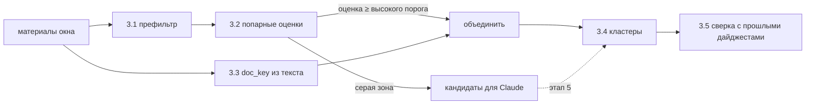

# Этап 3. Фильтр и дедупликация

**Цель.** Из материалов за окно получить список **сюжетов** (кластеров) по теме дайджеста:
- без дублей внутри дня;
- без повторов того, что уже выходило в прошлых дайджестах;
- новости об одном правовом акте собраны в один кластер, главный в нём — самый ранний материал.

**Оценка:** 3 дня. **Зависит от:** этапа 2 (полный текст и `legal/doc_key.py`). Серую зону сомнительных дублей решает Claude на этапе 5.

---

## Что выяснено на 347 реальных материалах (02.11.2026)

- **Дубли между СМИ почти всегда перефразированы.** Из 30 пар-кандидатов:
  - «Возбудили уголовное дело против Imarat Development» встречается **в 5 источниках** (gazeta, daryo, spot, podrobno, nuz) с разными формулировками;
  - «Мобильные радары не будут обозначать знаками» (daryo) и «Отменили знаки перед мобильными радарами» (uzdaily): **ни одного общего слова в заголовке** (Jaccard 0,00), хотя символьная похожесть 0,66;
  - «В Нукусе оштрафованы 22 газонаполнительные станции» (kun) и «Комитет по конкуренции оштрафовал 22 газовые заправки» (spot): общие только «Нукус» и «22».
- **Ложные совпадения тоже есть.** «Музеи Узбекистана и Петербурга договорились о сотрудничестве» и «Узбекистан и США договорились о сотрудничестве в сфере ИИ» дают символьную похожесть 0,63.
- **Выводы:**
  - сравнения заголовков мало;
  - сильный сигнал — общие **«якоря»**: числа (22, 187), латиница и имена собственные (Imarat Development);
  - сильный сигнал — пересечение **полного текста**;
  - перефразы без общих слов надёжно ловит только Claude. Он и так получает все кандидаты на этапе отбора (5a), и попросить его заодно сгруппировать сюжеты почти ничего не стоит.
- **Номера актов в анонсах RSS почти не встречаются:** 3 упоминания, все у norma: «от 28.10.2026 г. № 594», «№ 586», «УП-236». Новости о законах в СМИ обычно пишут «Президент подписал постановление» без номера. Номер есть в полном тексте (этап 2) или у norma и buxgalter. Поэтому `doc_key` ищется **по полному тексту**, а Claude на этапе 5 дополнительно извлекает реквизиты.
- **Простой фильтр по ключевым словам** (налог, банк, закон, штраф…) пропускает 153 из 347 материалов (44 %). Слишком широко, чтобы обойтись без Claude, но годится как дешёвый первый барьер **на полноту**: лучше пропустить лишнее, чем отсечь нужное.

---

## Подход

### 3.1 Префильтр — `src/uzdigest/filter/prefilter.py`, `config/keywords.yaml`
- Материалы уровней A и B проходят всегда.
- Уровень C отсекается в двух случаях:
  - **стоп-рубрики** по URL или категории RSS: спорт, погода, происшествия, культура, шоу-бизнес. Список рубрик на источник хранится в `sources.yaml` (`exclude_url_patterns`);
  - **стоп-темы** в заголовке, если в тексте нет ни одного тематического слова: ДТП, футбол, концерт, погода…
- Всё остальное помечается `prefilter=pass` и уходит дальше. Цель — снять около половины очевидного шума и ничего важного не потерять.

### 3.2 Попарная оценка — `src/uzdigest/dedup/similarity.py`
Для пар из разных источников в пределах 72 ч считаем признаки:
- **токены заголовка:** нижний регистр, обрезка слов до 5 букв (грубая замена стемминга: «возбудили» и «возбуждено» → «возбу»), без стоп-слов. Мера — Jaccard;
- **якоря:** числа, слова на латинице, слова с заглавной буквы не в начале предложения. Считаем число общих якорей;
- **шинглы текста:** 5-словные шинглы первых ~800 символов полного текста. Мера — Jaccard.

Итоговая оценка — простая формула с весами из `settings.yaml`. Решения:
- выше высокого порога — объединяем;
- в серой зоне — пара уходит Claude (этап 5);
- ниже — разные сюжеты.

В день около 150 материалов. Попарное сравнение — порядка 10 тысяч пар, это доли секунды, индексы вроде LSH не нужны.

### 3.3 Правовые ключи — `src/uzdigest/legal/doc_key.py` (расширение модуля этапа 2)
Извлечение реквизитов из **свободного текста** на ru, uz-латинице и uz-кириллице:

| Вид | Русский | Узбекский (латиница) | Узбекский (кириллица) |
|---|---|---|---|
| Закон | ЗРУ-1184, «Закон … № ЗРУ-1184» | O‘RQ-1184 | ЎРҚ-1184 |
| Указ | УП-236 | PF-236 | ПФ-236 |
| Постановление Президента | ПП-387 | PQ-387 | ПҚ-387 |
| Постановление Кабмина | «постановление Кабинета Министров / Кабмина / КМ от 28.10.2026 г. № 594» | VMQ-594 | ВМҚ-594 |
| Ведомственный акт | «рег. № 3956», «зарегистрирован Минюстом … № 3009-4» | — | — |

- **Год:** берём из ближайшего «от ДД.ММ.ГГГГ». Если даты нет, год публикации материала с флагом `year_guessed`.
- **Проект:** если рядом стоят слова «проект», «обсуждение», regulation.gov.uz, ставим `is_draft`.
- Результат пишется в `item_legal_refs`.
- Материалы с одним `doc_key` объединяются в кластер вида `legal`, независимо от похожести текста.

### 3.4 Кластеры — `src/uzdigest/dedup/clustering.py`
- Объединение пар через union-find. Источники связей: правовой ключ, высокая оценка и, после этапа 5, решения Claude.
- **Главный материал кластера** — самый ранний `published_at`. При равенстве выигрывает уровень A > B > C. Остальные идут в «Также писали».
- Кластеры пишутся в `clusters` и `items.cluster_id`. Статусы `items`: `primary` или `duplicate`; отсеянные префильтром — `filtered`.
- Кластеризация выполняется при сборке дайджеста по окну, а не при каждом `collect`.

### 3.5 Повторы между днями
- Перед выводом каждый кластер сравнивается с кластерами из `digest_entries` за последние 14 дней: по `doc_key` и по оценке 3.2 с главным материалом.
- Совпал — кластер помечается как повтор и не выводится.
- Исключение: у правового кластера статус сверки сменился с «ожидает» на «подтверждён». Он выводится строкой в блоке «Обновления» (этап 6).

### 3.6 Эталонная выборка и подбор порогов
- Команда `uzdigest dedup-report --days 3` выгружает в `data/dedup_pairs.csv` пары-кандидаты с признаками и пустой колонкой `same` (да/нет).
- Команда размечает 100+ пар. Пары из исследования выше уже готовые примеры.
- Скрипт `tests/eval_dedup.py` считает точность и полноту при разных порогах. Выбранные пороги записываются в `settings.yaml`.

---

## Задачи
1. **Миграция `003_dedup.sql`:**
   - `items.prefilter TEXT`, `items.prefilter_reason TEXT`;
   - `item_legal_refs.is_draft`, `item_legal_refs.year_guessed`;
   - таблица `pair_decisions(item_a, item_b, decision, source, created_at)` — решения правил и Claude для повторного использования.
2. **Конфиг:** `config/keywords.yaml` (тематические слова и стоп-темы, ru и uz), `exclude_url_patterns` в `sources.yaml`.
3. **Код:** `filter/prefilter.py`, `dedup/similarity.py`, `dedup/clustering.py`, расширение `legal/doc_key.py`, команда `dedup-report`.
4. **Пороги** и веса — в `settings.yaml`, секция `dedup`.

## Тесты
- **`doc_key`:** таблица из 30+ случаев, включая узбекские формы, «от … № …» без вида рядом, проекты, ложные срабатывания (номера телефонов, «№ 1 в рейтинге»).
- **Похожесть на реальных парах из исследования:**
  - Imarat Development ×5 — объединяются (через якорь «Imarat» и текст);
  - «Музеи…» и «США…ИИ» — не объединяются;
  - «мобильные радары» — попадают в серую зону, а не в «разные».
- **Кластеры:** главный = самый ранний, при равенстве по уровню. Правовой кластер собирается из материалов с разными заголовками.
- **Префильтр:** уровни A и B не отсекаются, стоп-рубрики отсекаются.

## Готово, когда
- На эталонной выборке у связки «правила + Claude» точность ≥ 95 % и полнота ≥ 90 %. До этапа 5 считаем по правилам, серая зона пока = «разные».
- `doc_key` находится у всех материалов norma и buxgalter, где в тексте есть номер акта (выборочная проверка 20 штук).
- Прогон на живом окне выдаёт список кластеров. Ручная проверка 30 кластеров: явных дублей нет.

## Риски
- **Порог слишком строгий или слишком мягкий.** Лечится эталонной выборкой и решениями Claude по серой зоне.
- **Номер акта без года** (например, «постановление № 594» без даты). Ключ с `year_guessed` объединяется только внутри окна и сверяется на этапе 4 по году публикации.

---

## Итоги реализации (02.11.2026)

Код: [prefilter.py](../../src/uzdigest/filter/prefilter.py), [similarity.py](../../src/uzdigest/dedup/similarity.py), [clustering.py](../../src/uzdigest/dedup/clustering.py), [stage.py](../../src/uzdigest/dedup/stage.py), [report.py](../../src/uzdigest/dedup/report.py), `find_refs` в [doc_key.py](../../src/uzdigest/legal/doc_key.py), словари [keywords.yaml](../../config/keywords.yaml), миграция [003_dedup.sql](../../src/uzdigest/db/schema/003_dedup.sql), скрипт [eval_dedup.py](../../tests/eval_dedup.py).

Всё проверено на 554–589 живых материалах за 30.10–02.11.2026. Решения, принятые по ходу работы:

- **Префильтр.** Тематическое слово для стоп-темы ищется не во всём тексте, а в заголовке и первых 300 знаках. Во всём тексте почти всегда находилось «сумов» или «компания», и фильтр снимал всего 7 % уровня C. Стоп-рубрика отсекает материал, только если в заголовке нет тематического слова: в «Происшествиях» бывают дела о мошенничестве застройщиков и банков. Рубрики RSS (`<category>`) теперь хранятся в `items.categories`: их отдают kun, daryo, uza, podrobno, nuz, kursiv, uzdaily. У уже собранных материалов рубрики дописываются при следующем опросе ленты.
- **Признак текста.** Вместо 5-словных шинглов используется Jaccard по основам слов первых 400 знаков. У перефразированных дублей шинглы почти не пересекаются (0,00–0,06), а основы слов дают 0,13–0,53 при 99-м перцентиле у случайных пар 0,10.
- **Основа слова** — слово без окончания, обрезанное до 5 букв. Простая обрезка давала «знака», «знако» и «знаки» для одного слова, и пересказы новости о радарах уходили в «разные».
- **Якоря** без дат («29 октября», «28.10.2026») и без названий органов («Кабинет», «Комитет», «Главное управление»): они есть в каждой второй новости и давали ложную похожесть.
- **Связь по правовому ключу** — только если материал об этом акте. Считается первое упоминание в первых 700 знаках, акт текущего или прошлого года, не проект, и в тексте не больше 3 актов. Иначе «UZEX увеличила объём сделок» склеивалась с «порядком торговли фьючерсами» через ПКМ № 82, упомянутый в конце заметки. Все упоминания всё равно пишутся в `item_legal_refs` для этапа 4.
- **Один акт — один кластер.** Так и задумано: заметки kun о мобильных радарах и о частных камерах для ремней безопасности — разные стороны ПКМ № 596. В дайджесте это одна статья с «Также писали».
- **Кластеры сохраняют id между пересборками**: если материал уже был в кластере, кластер переиспользуется. От id зависит кэш текстов Claude (`summaries`, этап 5). `dedup-report` кластеры в БД не пишет, это делает сборка дайджеста (`clustering.save_clusters`, этап 6).
- **`pair_decisions`** хранит решения Claude (`llm`) и команды (`manual`); при сборке они важнее правил, `manual` важнее `llm`.

### Предварительные пороги (до разметки)
Веса и пороги в `settings.yaml`, секция `dedup`: заголовок 0,40, якоря 0,25, текст 0,35. Не ниже 0,45 — один сюжет; 0,22–0,45 — серая зона; ниже — разные. Пары с оценкой 0,40–0,60 по просмотру глазами почти все дубли. В зоне 0,30–0,40 примерно половина пар — разные сюжеты об одном событии (саммит ОТГ, погода на разные дни).

### Живой прогон: `uzdigest dedup-report --days 3`
| Проверка | Результат |
|---|---|
| Время | 4 с на 554 материала |
| Префильтр | отсеяно 64 из 536 материалов уровня C (12 %): спорт, погода, происшествия, концерты. В выборке из 70 прошедших осталось 4 явно лишних, то есть снято около двух третей очевидного шума. Ни одного нужного материала среди отсеянных не нашлось |
| Сюжеты | 434, из них 37 с дублями (до 6 изданий: дело Imarat Development), 6 правовых |
| Ложные объединения | среди 37 кластеров с дублями не найдено |
| Серая зона | 211 пар за 3 дня, около 70 в день: почти все дубли, которые правила не объединили (радары у gazeta, daryo и kursiv; 22 заправки в Нукусе; «ДПС» и «двойная сплошная»), плюс много пар о саммите ОТГ. Их решит Claude на этапе 5 |
| `doc_key` у norma и buxgalter | найден у 7 из 7 материалов с номером акта. Восьмое совпадение — «форма №1 „Бухгалтерский баланс“», и это правильно не акт. Материалов с номерами в БД пока меньше 20, выборку расширим на пилоте |

### Что осталось команде
1. Открыть `data/dedup_pairs.csv` (Excel, разделитель «;») и заполнить колонку `same`: «да» или «нет». Нужно 100+ пар, лучше всего около порогов 0,22 и 0,45. При перезапуске `dedup-report` отметки сохраняются. Сделайте копию файла: папка `data/` не в git.
2. Запустить `.venv/Scripts/python.exe tests/eval_dedup.py`. Скрипт покажет точность и полноту при разных порогах и лучшие веса при точности ≥ 95 %. Выбранные значения записать в `settings.yaml`.
3. Метрику «правила + Claude ≥ 95 % / 90 %» можно посчитать после этапа 5, когда Claude решит серую зону.
